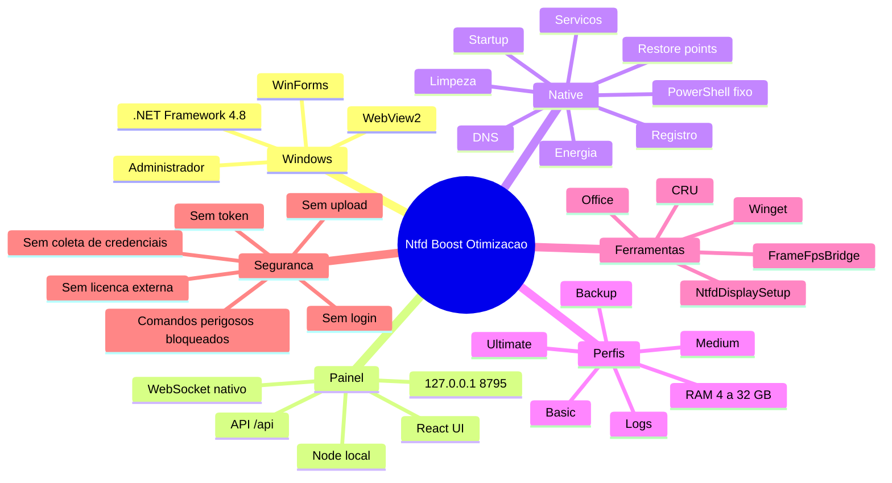
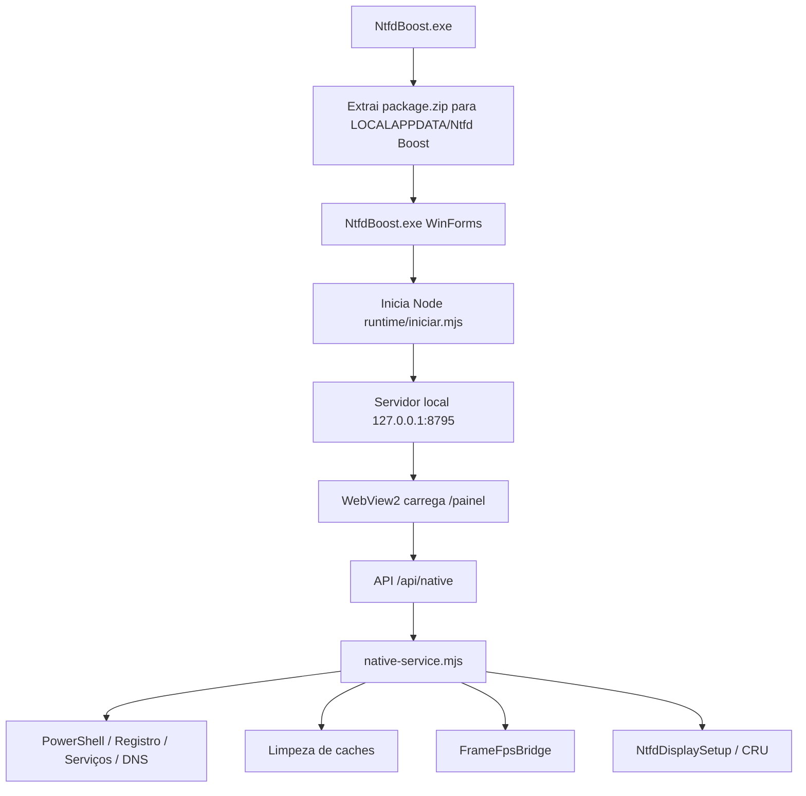
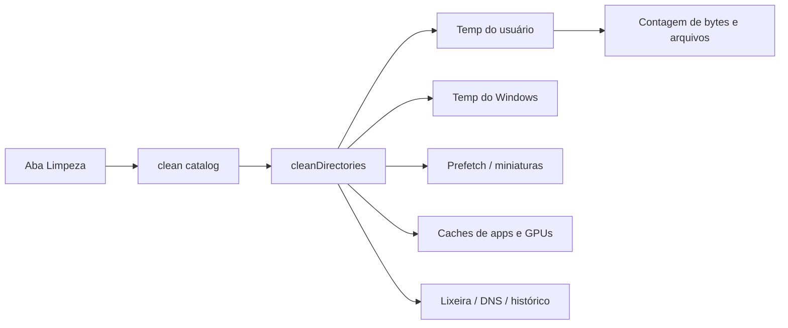
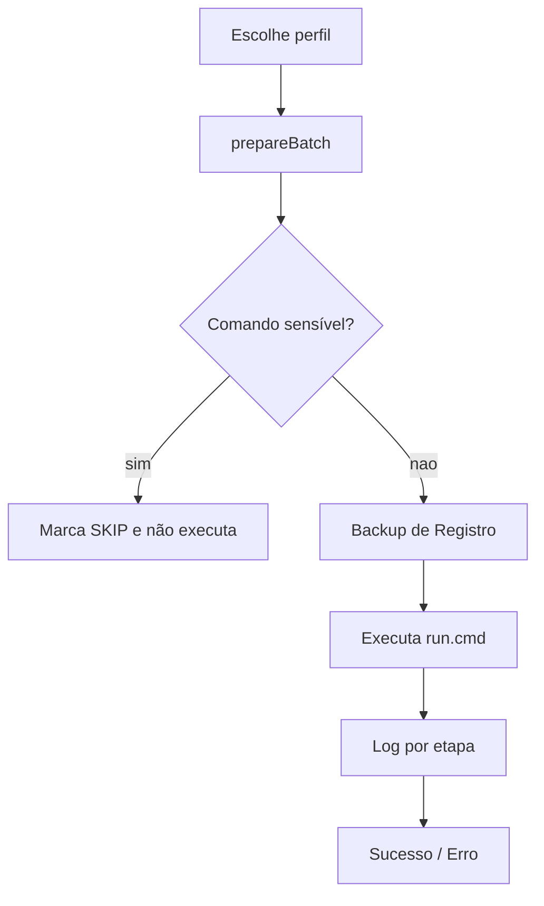

# Mapa mental — Ntfd Boost

> Arquitetura do aplicativo após a limpeza: sem autenticação externa, sem licença, sem OAuth e sem coleta de dados.
> Versão base: 1.0.

---

## 1. Visão geral



---

## 2. Fluxo do aplicativo



---

## 3. Limpeza



- `native-service.mjs` contém a lista fixa de diretórios.
- Caminhos são validados com `path.resolve` e `startsWith`.
- Links simbólicos são ignorados.
- A limpeza nunca recebe um caminho arbitrário do navegador.

---

## 4. Perfis Basic / Medium / Ultimate



Bloqueados automaticamente:

- `bcdedit`
- `vssadmin`
- `wevtutil`
- `schtasks`
- `format`, `diskpart`, `cipher`
- `net user`, `net localgroup`
- `netsh advfirewall`
- comandos de Defender
- serviços críticos de segurança
- `rd /s`, `del`, limpeza recursiva antiga

---

## 5. Estrutura do projeto

```text
Ntfd-Otimizacao/
├─ src/
│  ├─ NtfdApp/
│  │  ├─ UtilityApp.cs       Entrada e servidor Node
│  │  ├─ UtilityWindow.cs    WebView2 e ponte nativa
│  │  ├─ NtfdDisplay.cs      EDID/display
│  │  ├─ NtfdMouse.cs        Mouse/teclado
│  │  └─ NtfdGpu.cs          GPU
│  ├─ FrameFpsBridge/        Contador de FPS FiveM
│  └─ NtfdDisplaySetup/      Setup de display/EDID
├─ web/
│  ├─ painel/
│  │  ├─ server.mjs          API local
│  │  ├─ native-service.mjs  Ações nativas
│  │  ├─ profile-jobs.mjs    Perfis e backups
│  │  ├─ native-inputs/      Basic, Medium, Ultimate, RAM
│  │  └─ public/             UI
│  └─ runtime/node.exe
├─ tools/cru/
├─ lib/
├─ build_dist.py
└─ Build_Release.bat
```

---

## 6. Segurança

| Item | Estado |
|---|---|
| Autenticação/licença externa | Removido |
| Login Discord/OAuth | Removido |
| Store de usuário/senha | Removido |
| Store de credenciais Discord | Removido |
| Token de IA externo | Removido |
| Feedback remoto | Removido |
| Upload de dados | Não existe |
| Servidor | Apenas `127.0.0.1:8795` |
| Perfil local | Fixo (`Ntfd Boost`) |
| Comandos arbitrários | Não aceitos pelo `/api/native` |

---

## 7. Build

```text
Build_Release.bat
  └─ build_dist.py
       ├─ csc Roslyn
       ├─ NtfdBoost.exe
       ├─ FrameFpsBridge.exe
       ├─ NtfdDisplaySetup.exe
       ├─ painel/
       ├─ runtime/
       ├─ tools/cru/
       ├─ lib/
       ├─ package.zip
       └─ NtfdBoost.exe (single-file)
```

Saída: `dist/NtfdBoost.exe` e `NtfdBoost.exe` na raiz.

---

## 8. Limitações

- Precisa de administrador para muitos ajustes.
- O perfil Ultimate altera muitos serviços/Registro; use ponto de restauração.
- O contador de FPS depende do `conhost-v2.dll` do FiveM.
- CRU e WebView2 são dependências de terceiros.
- O app é local; não há conta, nuvem ou sincronização.
