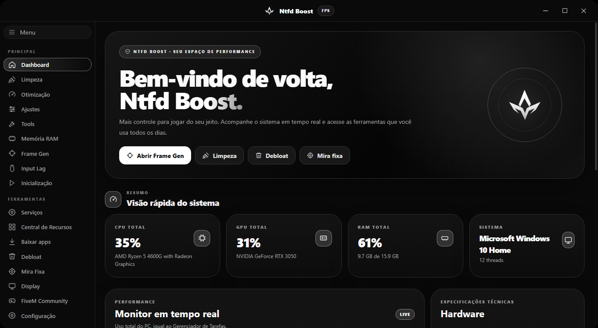
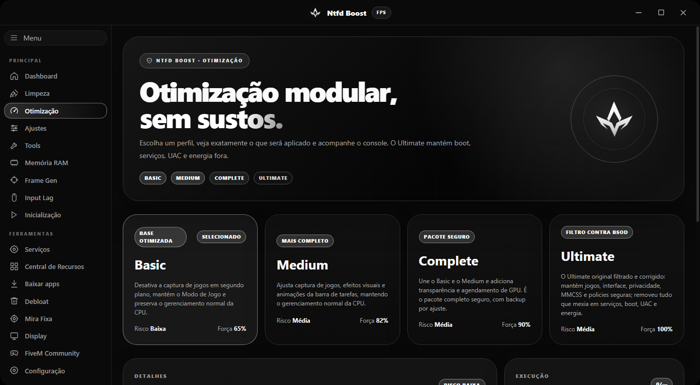
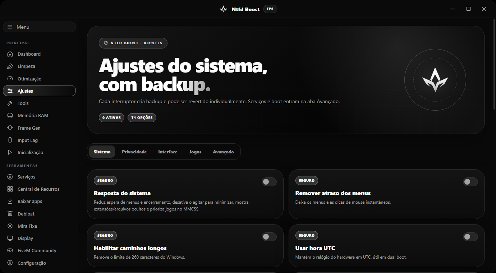
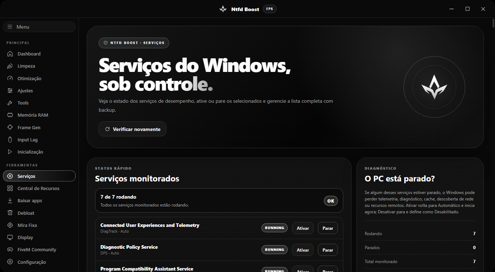
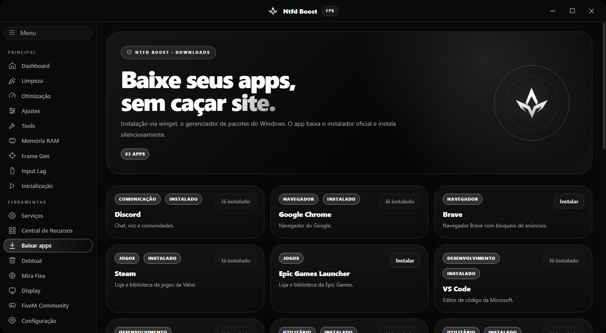
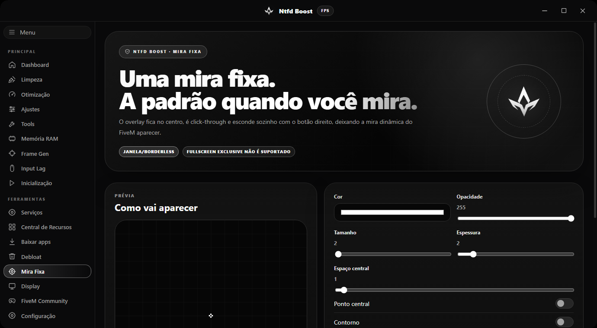
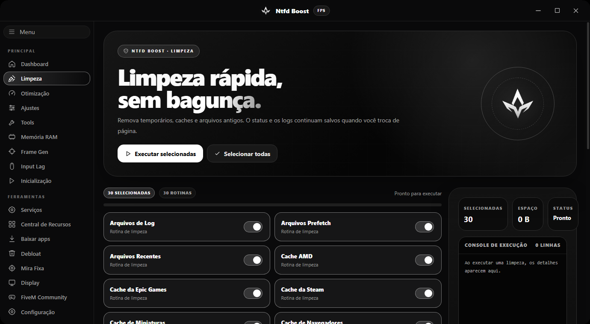
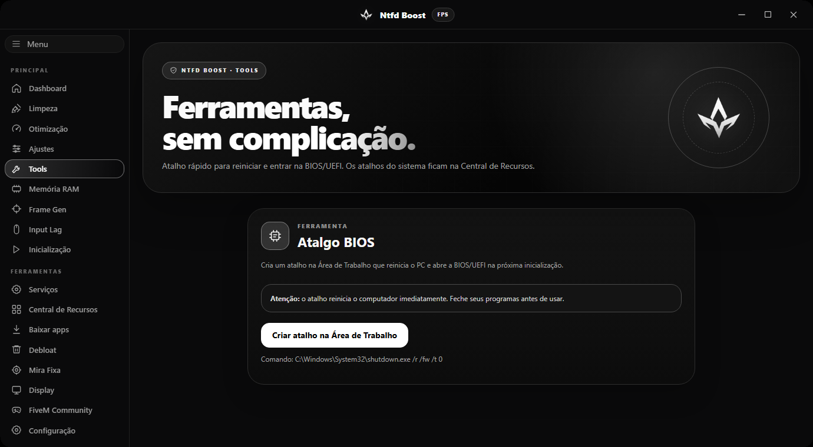

# Ntfd Boost

> Otimizador local para Windows 10/11 com painel em WebView2, 74 ajustes, gerenciamento de serviços, limpeza, downloads oficiais, mira fixa e contador de FPS para FiveM.

O Ntfd Boost reúne ferramentas de manutenção e desempenho em uma única janela. O painel roda em um servidor Node local (`127.0.0.1:8795`) e é exibido dentro de uma janela WinForms com WebView2.

> **Pacote:** o código-fonte está em `Ntfd-Boost.rar`, protegido por senha (RAR5/AES-256, com cabeçalhos criptografados). Extraia antes de compilar ou executar. O hash do arquivo está em `SHA256SUMS.txt`.

---

## Preview

| Dashboard | Otimização |
|---|---|
|  |  |

| Ajustes | Serviços |
|---|---|
|  |  |

| Downloads | Mira fixa |
|---|---|
|  |  |

| Limpeza | Ferramentas |
|---|---|
|  |  |

---

## Status

| Item | Valor |
|---|---|
| Plataforma | Windows 10/11 x64 |
| Interface | WinForms + WebView2 + painel local |
| Runtime | .NET Framework 4.8 + Node.js |
| Painel | HTTP local em `127.0.0.1:8795` |
| Ajustes | 74 opções com backup e reversão |
| Serviços | Catálogo com 267 serviços e proteções |
| Downloads | 23 aplicativos via winget ou link oficial |
| Login/licença externa | Removidos |
| Coleta de dados | Removida |
| Auto-update | Removido; atualização manual |
| Licença | Proprietária — todos os direitos reservados |

---

## Recursos

### Limpeza
- Temporários do usuário e do Windows.
- Prefetch, miniaturas, lixeira, Windows Update e Delivery Optimization.
- Caches de DirectX, NVIDIA, AMD, Intel, Discord, Spotify, VS Code, Steam, Epic, Riot, FiveM, Roblox, Minecraft e Rockstar.
- Limpeza de DNS e histórico de caminhos do Explorer.

### Ajustes
- 74 opções de sistema, privacidade, interface, jogos e avançado.
- Backup individual antes de aplicar e reversão pelo mesmo interruptor.
- Confirmação extra em ajustes de risco alto.
- Serviços, inicialização, boot, UAC, rede, energia e Windows Update.
- Aviso de reinício no cabeçalho quando uma opção exige reboot.

### Perfis
- **Basic**, **Medium**, **Complete** e **Ultimate** com log por etapa.
- Perfis de memória RAM para 4, 6, 8, 12, 16 e 32 GB.
- Comandos sensíveis de boot/segurança são bloqueados automaticamente.

### Serviços
- Catálogo com 267 serviços e 69 protegidos.
- Ativar, parar, definir como manual e restaurar.
- Backup do estado anterior por operação.
- Status dos serviços monitorados e diagnóstico.

### Downloads
- 23 aplicativos: navegadores, launchers, utilitários e segurança.
- Instalação via winget ou download direto oficial.
- Verificação SHA-256 nos downloads diretos.
- Botão **Site** para abrir a página oficial/afiliada.
- Rufus, IPVanish e Malwarebytes incluídos.

### Mira fixa
- Overlay central, click-through e que esconde com o botão direito.
- Controles de cor, opacidade, tamanho, espessura, espaçamento, ponto e contorno.
- Apenas **Ativar** e **Desativar**.
- Funciona em borderless/windowed; fullscreen exclusive não é suportado.

### Outros
- Contador de FPS para FiveM (`FrameFpsBridge`).
- Ferramentas de display/EDID com CRU.
- Ajustes de mouse e teclado.
- DNS (Google, Cloudflare, Quad9, OpenDNS ou personalizado).
- Pontos de restauração do Windows.
- Atalho na Área de Trabalho criado na primeira execução.

---

## Requisitos

- Windows 10/11 x64.
- .NET Framework 4.8.
- WebView2 Runtime.
- Node.js 20+ (ou o `runtime/NtfdBoostRuntime.exe` incluído no instalador).
- Permissões de administrador para ajustes que alteram serviços, Registro ou energia.

---

## Como compilar

```bat
python build_dist.py
```

O script:

1. Compila `NtfdBoost.csproj`, `FrameFpsBridge.csproj` e `NtfdDisplaySetup.csproj`.
2. Monta `dist/package` com painel, runtime, WebView2 e CRU.
3. Gera `dist/NtfdBoost.exe`, `dist/NtfdBoost-Setup.exe` e `NtfdBoost.exe` na raiz.
4. O instalador extrai o pacote para `%LOCALAPPDATA%\NtfdBoost` e inicia o painel.

Requisitos de build:

- Visual Studio 2022 com C#/Roslyn (`csc.exe`).
- Python 3.
- .NET Framework 4.8 Developer Pack.

---

## Estrutura

```text
Ntfd-Otimizacao/
├─ src/
│  ├─ NtfdBoostApp/          Aplicativo WinForms + WebView2
│  ├─ FrameFpsBridge/        Contador de FPS para FiveM
│  └─ NtfdDisplaySetup/      Utilitário de EDID/display
├─ web/
│  └─ painel/
│     ├─ server.mjs          API local e arquivos estáticos
│     ├─ native-service.mjs  Ações nativas (limpeza, Registro, DNS etc.)
│     ├─ profile-jobs.mjs    Execução dos perfis com backup/log
│     ├─ download-catalog.json
│     ├─ optimizer-catalog.json
│     └─ public/ui/          Painel (HTML/CSS/JS)
├─ tools/cru/                Custom Resolution Utility (terceiros)
├─ lib/                      DLLs do WebView2
├─ docs/screenshots/         Imagens deste README
├─ build_dist.py
├─ MapaMentalNtfd.md
└─ README.md
```

> Para a arquitetura completa, veja [`MapaMentalNtfd.md`](MapaMentalNtfd.md).

---

## Segurança e privacidade

- O painel escuta apenas em `127.0.0.1:8795`.
- Não há login, chave, conta externa ou coleta de dados.
- Nenhum dado é enviado para servidores.
- Backups de Registro, serviços e arquivos ficam em `%LOCALAPPDATA%\NtfdBoost`.
- O app não possui auto-update; cada versão é distribuída manualmente.
- Ajustes de sistema podem exigir reinicialização e devem ser revertidos com os backups gerados.

### Falso positivo em antivírus

O executável não é assinado. Por alterar Registro, serviços e inicialização, alguns motores podem marcar o app por heurística. O SHA-256 e as orientações estão em [`VIRUSTOTAL.md`](VIRUSTOTAL.md). Sem certificado de code signing, não é possível garantir zero detecções.

---

## Licença

**Proprietária — todos os direitos reservados.** Veja [`LICENSE`](LICENSE).

Nenhuma permissão é concedida para usar, copiar, modificar, publicar, distribuir, sublicenciar ou vender este software sem autorização prévia por escrito do autor.

---

## Créditos

- Microsoft WebView2
- Node.js
- Custom Resolution Utility (CRU), de monitortests.com
- Bibliotecas de terceiros mantêm suas próprias licenças.
